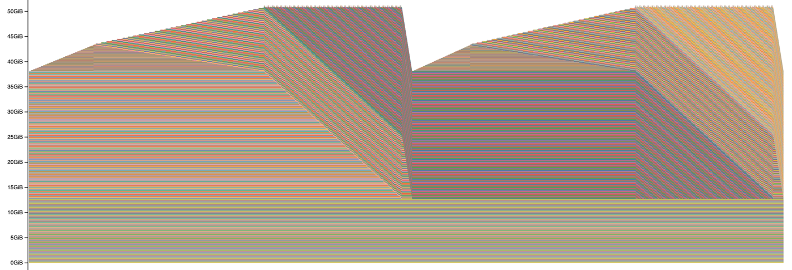
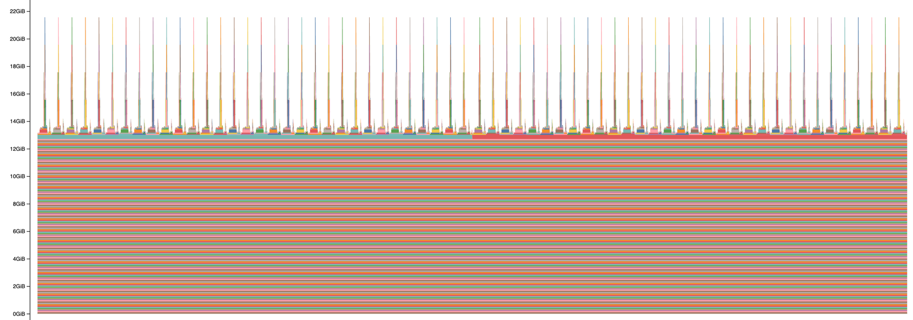

# CS336 Assignment 2 — Written Answers

## 2.1.3 Problem (benchmarking_script): Benchmarking Script

**(a)** Script in cs336_systems/benchmark.py

**(b)**

| B200 (fp32, TF32 matmuls), batch 4, context 512 | small      | medium     | large      | xl           | 10B |
|-------------------------------------------------|------------|------------|------------|--------------|-----|
| forward (ms)                                    | 14.9 ± 0.4 | 25.0 ± 2.4 | 34.2 ± 0.7 | 52.4 ± 0.4   | OOM |
| backward (ms)                                   | 21.6 ± 0.8 | 37.7 ± 2.7 | 67.2 ± 0.3 | 125.5 ± 1.6  | OOM |
| optimizer step (ms)                             | 10.0 ± 0.4 | 17.1 ± 1.3 | 24.9 ± 0.5 | 70.35 ± 0.04 | OOM |
| backward / forward                              | 1.45×      | 1.51×      | 1.96×      | 2.39×        | –   |

Backward pass is 1.5-2.4x forward pass depending on the model size, which is expected, low variability in both forward pass and optimizer step, significant variability in backward pass.

**(c)**

I ran experiments on small and xl models:

| small: warmup steps | forward (ms)   | backward (ms) | optimizer step (ms) |
|---------------------|----------------|---------------|---------------------|
| 0                   | 60.08 ± 121.45 | 32.05 ± 31.63 | 9.84 ± 1.25         |
| 1                   | 17.58 ± 5.81   | 28.40 ± 9.72  | 11.43 ± 3.58        |
| 2                   | 12.60 ± 0.14   | 19.60 ± 0.44  | 8.87 ± 0.06         |
| 5 (part b)          | 14.89 ± 0.42   | 21.62 ± 0.80  | 9.95 ± 0.38         |

| xl: warmup steps | forward (ms)    | backward (ms)  | optimizer step (ms) |
|------------------|-----------------|----------------|---------------------|
| 0                | 103.90 ± 118.73 | 135.13 ± 16.19 | 73.91 ± 11.80       |
| 1                | 65.98 ± 43.09   | 129.85 ± 14.53 | 70.13 ± 0.11        |
| 2                | 53.53 ± 0.46    | 126.70 ± 1.03  | 70.57 ± 0.06        |
| 5 (part b)       | 52.39 ± 0.40    | 125.45 ± 1.58  | 70.35 ± 0.04        |

| no warmup (ms)       | step 1 | step 2 | steps 3–10 (median) |
|----------------------|--------|--------|---------------------|
| small forward        | 399.6  | 87.0   | 14.1                |
| small backward       | 121.9  | 24.9   | 20.9                |
| small optimizer step | 12.9   | 9.4    | 9.1                 |
| xl forward           | 411.4  | 208.9  | 52.4                |
| xl backward          | 161.7  | 125.7  | 125.3               |
| xl optimizer step    | 107.5  | 70.1   | 70.1                |

We can observe that with no warmup the times stabilize only from 3rd step onward and at the same time that with 2 and 5 warmup iters the standard deviation and mean were very similar.

This is most likely caused by two things:

1. How CUDA loads kernels into the GPU lazily on first use and initializes cuBLAS on first matmul
2. How pytorch expands reserved memory on the GPU, only if its already reserved (and freed) pool won't fit the data:

- Initially it only allocates memory for weights (W),
- On the first forward pass it allocates memory for activations (A),
- Then on the backward pass it allocates memory for gradients (G) and at the same time frees memory for activations, but it expanded reserved memory pool to W + A + G
- Then on optimizer pass it allocates memory for momentum state (M = 2G) => W + A + G + 2G - A = W + 3 G, because it only had to grow memory by some portion 2G - A, that wasn't reserved yet
- Then after the optimizer pass the gradients are freed (but kept in the reserved pool by pytorch), so the used memory stays as W + 2G, while reserved memory is W + 3G

This means, that in the first pass, it only had to grow the memory to W + 3G.

Then during second pass, it needs to allocate memory for activations again, so it grows to W + 2G + A, (A is typically bigger than G in our case - depends on input size, so W + 2G + A > W + 3G - A).
That's when the memory pool stabilizes and it expanded to the maximum, which is W + 2G + A. In the next steps there will be no new memory allocation needed, so that's why the steps are quicker from
this point on.

## 2.1.4 Problem (nsys_profile): Nsight Systems Profiling

**(a)**

| model, context (batch 4, fp32/TF32) | GPU       | `timeit` forward (ms) | NVTX `forward` range, CPU (ms) | NVTX `forward` range, GPU projection (ms) | `timeit` backward (ms) | `timeit` optimizer step (ms) |
|-------------------------------------|-----------|-----------------------|--------------------------------|-------------------------------------------|------------------------|------------------------------|
| small, 512                          | A100 SXM4 | 30.13 ± 1.36          | 30.11                          | 29.91                                     | 49.22 ± 2.90           | 22.56 ± 1.09                 |
| small, 1024                         | A100 SXM4 | 47.26 ± 0.35          | 47.24                          | 46.99                                     | 100.56 ± 0.33          | 26.87 ± 0.70                 |
| small, 2048                         | A100 SXM4 | 144.97 ± 0.29         | 144.93                         | 144.77                                    | 301.96 ± 0.23          | 22.54 ± 0.49                 |
| large, 256                          | A100 SXM4 | 89.31 ± 4.88          | 89.29                          | 89.12                                     | 139.30 ± 4.30          | 85.08 ± 0.10                 |
| large, 512                          | A100 PCIe | 101.00 ± 2.42         | 100.97                         | 100.80                                    | 227.31 ± 0.87          | 89.23 ± 0.45                 |
| large, 1024                         | A100 SXM4 | 243.41 ± 0.29         | 243.28                         | 242.98                                    | 528.08 ± 0.74          | 85.69 ± 0.39                 |

Our forward pass measured both by timeit and NVTX is almost the same, under 0.5% difference. Total time spent for 10 iterations was around 301ms on small model 512 context length.

**(b)**

During the small models 512 context length forward pass following kernel takes most time:

| Time  | Total Time | Instances | Avg       | Med       | Min       | Max       | StdDev    | Name                                                                                      |
|-------|------------|-----------|-----------|-----------|-----------|-----------|-----------|-------------------------------------------------------------------------------------------|
| 18.8% | 3.012 ms   | 36        | 83.680 μs | 90.848 μs | 68.672 μs | 91.520 μs | 10.472 μs | `void cutlass::Kernel2<cutlass_80_tensorop_s1688gemm_128x128_16x5_tn_align4>(T1::Params)` |

It was invoked 36 times in a single forward pass.

For both forward and backward passes together the kernel that takes most time is "void at::native::vectorized_elementwise_kernel<(int)4, at::native::BinaryFunctor<float, float, float, at::native::
binary_internal::MulFunctor<float>>, std::array<char *, (unsigned long)3>>(int, T2, T3)"

**(c)**

vectorized_elementwise_kernel and elementwise_kernel which are PyTorch's generic element-wise kernels, not matrix multiplications, like: add, multiply, divide, exp, copy and so on.
They are memory bound, not compute, that's why they take significant amount of time even though contributing almost no FLOPs.

**(d)**

| small, context 512 | matmul | element-wise | reduction | copy | other |
|--------------------|--------|--------------|-----------|------|-------|
| forward only       | 36.3%  | 49.6%        | 8.7%      | 4.1% | 1.3%  |
| full training step | 28.4%  | 60.3%        | 5.2%      | 5.7% | 0.4%  |

When we compare forward vs. full training step, then we can notice that matmul fraction decreases from 36.3% to 28.4%, while element-wise fraction increases from 49.6% to 60.3%. Reduction decreases
from 8.7% to 5.2% and copy increases from 4.1% to 5.7%.

**(e)**

| small, context 512, one attention call | FLOPs       | time     | achieved throughput |
|----------------------------------------|-------------|----------|---------------------|
| matmuls (QKᵀ + ·V)                     | 3.22 GFLOP  | 99.3 µs  | ~32 TFLOP/s         |
| softmax                                | 0.063 GFLOP | 364.1 µs | ~0.17 TFLOP/s       |

Softmax contributes ~50x less FLOPs but takes ~3.7x more time. What's interesting is also that in QKᵀ / √dₖ the element-wise division takes more time (54.6%) than the matmul itself (45.4%).

## 2.1.5 Problem (mixed_precision_accumulation): Mixed-Precision Accumulation

So first thing to notice is, by adding from 0.01 1000 times, we cross multiple float exponents, resulting in different spacing.
This results in different accumulating error depending on the accumulator and the addend.

The results are as following:

accumulator=fp32, addend=fp32:                  tensor(10.0001)
Spacing eg. in 8-16 range for fp32 is 0.00000095, adding 0.01 (0.0099999998 in fp32) produces error, since accumulator is of same precision,
these small rounding error get dragged through different exponent ranges, so it accumulates and we receive 10.0001.

accumulator=fp16, addend=fp16:                  tensor(9.9531, dtype=torch.float16)
Spacing eg. in 8-16 range for fp16 is 0.0078125, adding 0.01 (0.0100021 in fp16) 250 times (we reach ~8 after 750 additions already because of 0.039 spacing in [4, 8) range of fp16,
resulting in rounding of 0.01 to 0.0117) accumulates error of −0.547, resulting in total error of −0.049. Previous coarser ranges in lower exponents made the value higher than expected,
the rounding error was positive of +0.498 and went to a negative one when arriving at 1000 additions.

accumulator=fp32, addend=fp16:                  tensor(10.0021)
In this case we're adding each time 0.0100021 (fp16 representation of 0.01) 1000 times, but fp32 is capable of storing finer grained values, so this error simply accumulates 1000 times and we land at
10.0021.
Pytorch is upcasting the value 0.0100021 to fp32 for us when we're doing the addition.

accumulator=fp32, addend=fp16->upcast fp32:     tensor(10.0021)
Here it does not matter if we upcast manually or not, pytorch would upcast automatically based on the accumulator type, we already created 0.0100021 as our representation of 0.01 in fp16,
and we're storing it in higher precision fp32, also resulting in same error accumulating 1000 times.

## 2.1.5 Problem (benchmarking_mixed_precision): Benchmarking Mixed Precision

**(a)**

1. fp32, model parameters are never autocasted
2. fp16, linear layer output can be autocasted to fp16
3. fp32, layer_norm can only be autocasted to fp32
4. fp16, linear layer output can be autocasted fo tp16
5. fp32, cross_entropy can only be autocasted to fp32
6. fp32, grad has always same dtype as parameters

**(b)**

So LayerNorm is:
mean = (1/d) · Σ xᵢ
var = (1/d) · Σ (xᵢ − mean)²
y = (x − mean) / √(var + ε) · γ + β,

mean:

- adding small values accumulates to a significant rounding error over many elements with fp16 precision - precision problem
- sum can overflow before dividing

var

- subtracting mean from every element for large values results in cancellation - precision problem
- sum can overflow
- squaring it can result in value exceeding range of fp16 - overflow

y

- subtracting mean can result in cancellation - precision problem
- adding epsilon can result in value not changing at all (absorption) - precision problem
- dividing can result in overflow if the denominator is small

With BF16 the range issues (overflow/underflow) are solved, since its same range as fp32, but the precision problems are even bigger, so to fix those we would need to upcast those operations to fp32
(the accumulator needs to be in fp32 like in our experiment in mixed_precision_accumulation problem).

**(c)**

| model (ctx 512, batch 4) | GPU       | forward fp32 (ms) | forward bf16 (ms) | speedup | backward fp32 (ms) | backward bf16 (ms) | speedup |
|--------------------------|-----------|-------------------|-------------------|---------|--------------------|--------------------|---------|
| small                    | A100 SXM4 | 22.97 ± 0.19      | 24.84 ± 0.47      | 0.92×   | 40.02 ± 0.34       | 35.89 ± 2.19       | 1.12×   |
| medium                   | A100 SXM4 | 49.32 ± 1.14      | 45.95 ± 0.29      | 1.07×   | 110.55 ± 0.91      | 92.85 ± 0.74       | 1.19×   |
| large                    | A100 SXM4 | 92.42 ± 0.11      | 101.22 ± 5.37     | 0.91×   | 212.39 ± 0.24      | 170.58 ± 0.48      | 1.25×   |
| xl                       | A100 SXM4 | 198.24 ± 2.66     | 156.26 ± 0.21     | 1.27×   | 466.42 ± 4.35      | 339.73 ± 1.06      | 1.37×   |

We can see a steady speedup in backward pass. Forward pass speedup is not so steady and is varying depending on the model size, that is likely caused by overhead added by the extra kernels from
autocast
while only giving speedups in minority of time that matmuls take in the forward pass itself.

## 2.1.6 Problem (memory_profiling): Memory Profiling

**(a)**

For 128 context length the forward pass memory is not very interesting and mostly low and flat, only barely moving above weights memory.

Training run memory of 128 context length looks as on the image:

We can see clear phases of forward pass, then backward pass, then optimizer step and then zero grad releasing memory, repeated twice since I ran 2 iterations.

For 2048 context length we can see big memory peaks from the attention blocks since its memory depends on squared context length:

Training run with 2048 context crashes with OutOfMemoryError during forward pass, since activations with such big context length exceed our maximum memory.

**(b)**

| Context length | Forward pass peak memory (GiB) | Full training peak memory (GiB) |
|----------------|--------------------------------|---------------------------------|
| 128            | 12.8                           | 51.3                            |
| 2048           | 21.6                           | 78.5                            |

I ran my experiments on A100-80GiB, therefore it crashed around 80GiB

**(c)**

| xl, batch 4                      | fp32 peak                          | bf16 (autocast) peak               |
|----------------------------------|------------------------------------|------------------------------------|
| context 128, inference           | 12.79 GiB                          | 19.02 GiB                          |
| context 128, full training step  | 51.29 GiB                          | 51.28 GiB                          |
| context 2048, inference          | 21.58 GiB                          | 25.40 GiB                          |
| context 2048, full training step | OOM in forward, at layer ~10 of 32 | OOM in forward, at layer ~14 of 32 |.

So for inference it increases memory usage, because autocast copies weights into bf16 and keeps them until the block ends.
On short context the memory peak with bf16 stays same as with fp32, because the activations in attention are small,
with long context this changes dramatically and activations inside attention layers cause bigger peaks than the baseline
from weights, gradients and momentums, meaning storing those attention activations in bf16 would reduce the effective peak memory.
